<!-- One continuous sheet: every panel is an image in its section's pale tint (sakura links + about, lavender
     work, periwinkle toolbox, peach contributions), with all text on cream panels. Images are placed with
     align="top" and no whitespace between tiles of a row, so GitHub renders them with no gaps.
     Generated by make_v12/ (python3 make_v12/build.py); the snake is drawn daily by .github/workflows/snake.yml. -->

<a href="https://zhenzhenfufu.github.io/Zhen-Wang-Personal-Website.github.io/">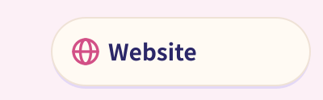</a><a href="https://www.linkedin.com/in/zhen-wang-63b09136b">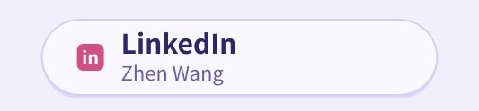</a><a href="https://ucsd-course-planning-tutor.streamlit.app/">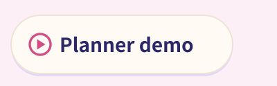</a>

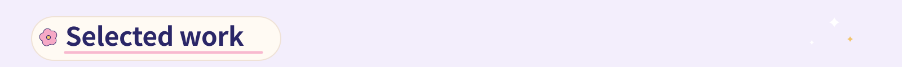
<a href="https://github.com/yuema137/SIDERIUS"></a><a href="https://github.com/zhenzhenfufu/ucsd-course-planning-tutor"></a>
<a href="https://zhenzhenfufu.github.io/Zhen-Wang-Personal-Website.github.io/majorana.html"></a><a href="https://zhenzhenfufu.github.io/Zhen-Wang-Personal-Website.github.io/night-water-academy.html"></a>
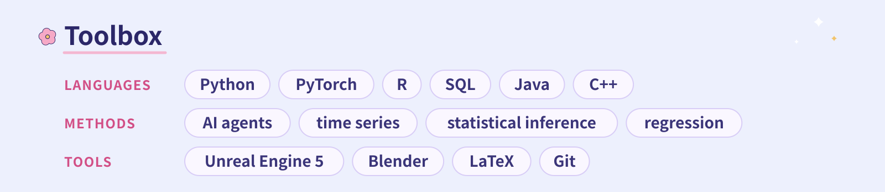


