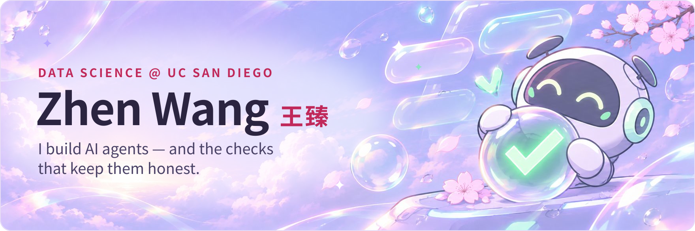
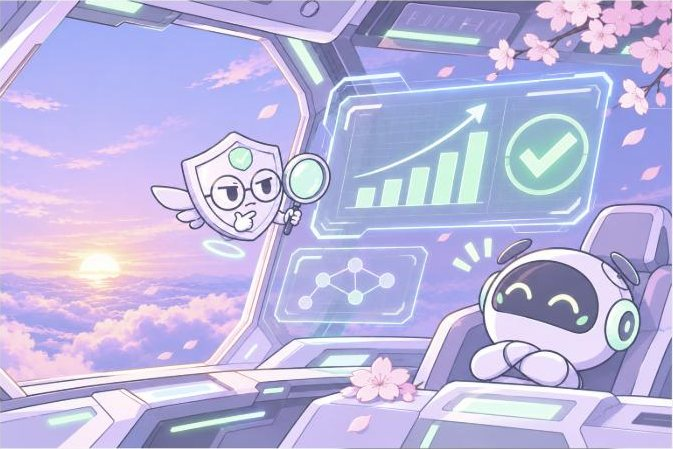
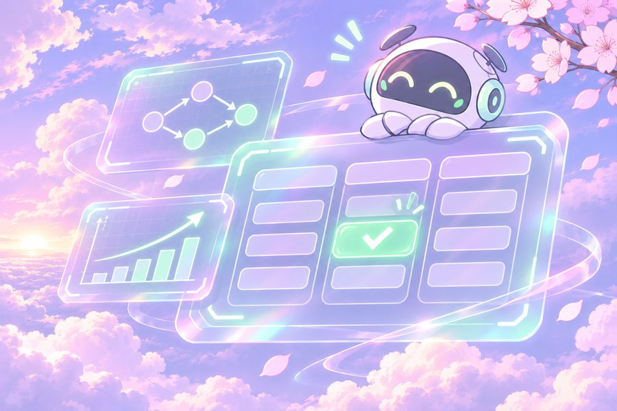
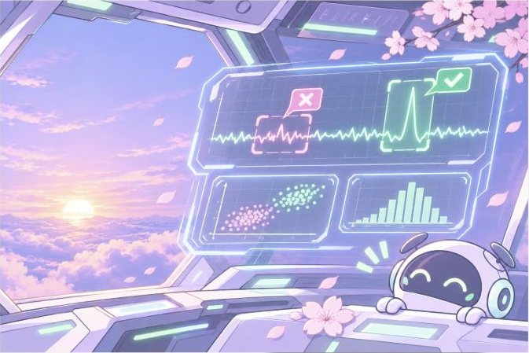
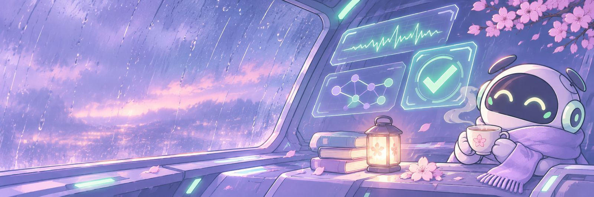

  <a href="https://zhenzhenfufu.github.io/Zhen-Wang-Personal-Website.github.io/"><b>Website</b></a> ·
  <a href="https://www.linkedin.com/in/zhen-wang-63b09136b"><b>LinkedIn</b></a> ·
  <a href="mailto:zhw124@ucsd.edu"><b>zhw124@ucsd.edu</b></a>

**Now.** In Prof. Aobo Li's Rare AI Lab at UC San Diego I work on [SIDERIUS](https://github.com/yuema137/SIDERIUS), an open-source agent that turns a dataset and a research question into an iterative machine-learning experiment and checks validity beside the score. I test its orchestration mode and run it end to end on Project 8 physics data. If you have a dataset and a question, try it and open an issue.

**Before.** AI Agent Development Intern at Pfizer China R&D (summer 2026): a regulatory-filing system where deterministic code decides and review agents only advise.

### Selected work

<table>
<tr>
<td width="50%" valign="top">

 <b><a href="https://github.com/yuema137/SIDERIUS">SIDERIUS</a></b> · open-source auto-ML agent for science 
Contributor · orchestration testing, Project 8 physics data
</td>
<td width="50%" valign="top">

 <b><a href="https://github.com/zhenzhenfufu/ucsd-course-planning-tutor">UCSD Course Planner</a></b> · the model proposes, a checker decides 
Prerequisite graph from the catalog · <a href="https://ucsd-course-planning-tutor.streamlit.app/">live demo</a>
</td>
</tr>
<tr>
<td width="50%" valign="top">

 <b><a href="https://zhenzhenfufu.github.io/Zhen-Wang-Personal-Website.github.io/majorana.html">Signal or Background?</a></b> · Majorana detector waveforms 
Residual 1D CNN · self-training on 65k unlabelled waveforms
</td>
<td width="50%" valign="top">

 <b><a href="https://zhenzhenfufu.github.io/Zhen-Wang-Personal-Website.github.io/night-water-academy.html">Night Water Academy 夜水书院</a></b> · UE5 puzzle game 
Producer · team of 5 · Tsinghua × miHoYo competition (judging in progress)
</td>
</tr>
</table>

### Toolbox

`Python` `PyTorch` `R` `SQL` `Java` `C++` · `AI agents` `time series` `statistical inference` `regression` · `Unreal Engine 5` `Blender` `LaTeX` `Git`

### Contributions, eaten

<picture>
  <source media="(prefers-color-scheme: dark)" srcset="https://raw.githubusercontent.com/zhenzhenfufu/zhenzhenfufu/output/snake-dark.svg">
  
</picture>

Illustrations generated with ChatGPT; the Night Water Academy image is an in-game screenshot.
