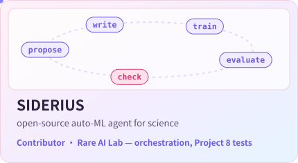

  <a href="https://zhenzhenfufu.github.io/Zhen-Wang-Personal-Website.github.io/"><b>Website</b></a> ·
  <a href="https://www.linkedin.com/in/zhen-wang-63b09136b"><b>LinkedIn</b></a> ·
  <a href="mailto:zhw124@ucsd.edu"><b>zhw124@ucsd.edu</b></a>

**Now.** I work in Prof. Aobo Li's Rare AI Lab at UC San Diego on [SIDERIUS](https://github.com/yuema137/SIDERIUS), an open-source agent that turns a dataset and a research question into an iterative machine-learning experiment, and checks validity beside the score. I test its orchestration mode and run it end to end on Project 8 physics data. It is open source and we want it used: if you have a dataset and a question, try it and open an issue when something breaks.

**Before.** AI Agent Development Intern at Pfizer China R&D (summer 2026), building a regulatory-filing system in which deterministic code makes every decision and review agents only advise.

### Selected work

  
  

  
  

Course planner live demo: <a href="https://ucsd-course-planning-tutor.streamlit.app/">ucsd-course-planning-tutor.streamlit.app</a> · every card links to the code or a write-up.

### Toolbox

`Python` `PyTorch` `R` `SQL` `Java` `C++` · `AI agents` `time series` `statistical inference` `regression` · `Unreal Engine 5` `Blender` `LaTeX` `Git`

### Contributions, eaten

<picture>
  <source media="(prefers-color-scheme: dark)" srcset="https://raw.githubusercontent.com/zhenzhenfufu/zhenzhenfufu/output/snake-dark.svg">
  
</picture>
